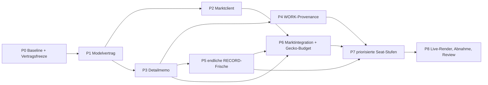

# Surf-Datenladen: Implementierungsplan

> **Für Agency-Implementierer:** `CLAUDE.md` hat Vorrang. Umsetzung als Tier 2 durch einen **Agents Orchestrator**, mit genau einem Implementierer je Arbeitspaket. Die Planungsmethode folgt `writing-plans`; die projektspezifische Tier-Pipeline ersetzt dessen allgemeinen Dispatch-/Reviewablauf. Dies ist der freigegebene Umsetzungsplan.

**Umsetzungsstand:** P0–P5 und der P6-Pflichtumfang sind implementiert und abschließend geprüft; der Gesamtreview ist nach einer finalen Fixwelle und begrenzter Nachprüfung freigegeben. P8-Nachweise sind dokumentiert, vollständige RECORD-Liveabnahme und vergleichbare Latenzmessung bleiben offen. Die bedingten P6-Einheiten 3/4 und P7 sind mangels vollständiger Baseline ausdrücklich zurückgestellt. Messgrenzen, Reviewkorrekturen, Testnachweise und bestehende Fehler stehen in [den Ausführungsnotizen](surf_data_loading_followups.md).

**Ziel:** Marktwerte dem richtigen Pool zuordnen, erfolgreiches ETH/USD unabhängig erhalten und mehrfach benötigte Swarm-Jobdetails mit begrenzter Frische gemeinsam verwenden. Ausgewählte RECORD-Inhalte sollen bei nachgewiesener Blockierung früher erscheinen, ohne Membership, Submission-Identität oder WORK-Vollständigkeit zu schwächen.

**Architektur:** Bestehendes Client → Cache → Manager → Screen → Widget bleibt erhalten. `SurfClient` trennt Poolmarkt und ETH-Referenz; `SwarmClient` erhält ein internes Detailmemo mit geteilten laufenden Abrufen. Der Manager publiziert abgeschlossene Datenfamilien und projiziert zusammengehörige Snapshot-Versionen synchron; Widgets bleiben reine Renderer.

**Stack:** Python ≥ 3.11, asyncio, httpx, Textual, pytest; keine neuen Abhängigkeiten. **Spezifikation:** [surf_data_loading_spec.md](surf_data_loading_spec.md). **Grundlagen:** [Marktdatenbericht](reports/Keyless%20Marktdaten%20für%20Surfboard.md) und [Swarmbericht](reports/Schnelle%20Navigation%20zwischen%20Schwarmjobs.md), jeweils 17.10.2026.

## Verbindliche Grenzen und angewandte Skills

- „Strictly read-only“, „Keyless“ und „No test touches the network“ aus `CLAUDE.md` gelten unverändert. Keine Signaturen, bezahlten Jobs, Secrets, Transaktionen oder neuen Provider.
- Fehlende oder ungültige Zahlen bleiben `None`; null Cap ist kein FDV. Token-Aggregate sind kein Poolvolumen. Erfolgreiches HTTP 200 ohne fachlich gültige Felder ist kein Erfolg.
- Referenzpool, Hook-/POOL4-Pool, Chain und Tokenorientierung bleiben getrennt. Kein Mitteln widersprüchlicher Anbieterwerte, keine neuen Supply-/Decimals-Annahmen und kein zusätzlicher Historienindexer.
- Aktuelle Surf-Anzeigevorgabe bleibt bestehen: interne Fehler/Frische/Last-good, neutrale fehlende Werte, keine neuen Stale-/Failure-Banner, keine neuen Tasten oder Modalnavigation. Geöffnete Modals bleiben Snapshots.
- Scores bleibt ein abgekoppelter Sweep; er wird nicht zum Navigationslock. WORK publiziert weiterhin atomisch mit Projekt-, Workflow-, Versions- und Node-Kantenkontext.
- Bestehende RECORD-Fenster 40–400, Retention 400 Einträge/48 h, höchstens vier Submission-Jobs und zwei normale Detail-Jobs je Zyklus bleiben erhalten. Früh priorisierte Membership zählt zum bestehenden Gesamtbudget von 64 Jobs, Viererparallelität bleibt.
- Ethskills: [indexing](/Users/banse/.codex/skills/ethskills/references/indexing.md) → Quellen-/Chain-/Poolidentität und getrennte Beobachtungszeiten; vorhandene Same-block-Multicalls wiederverwenden. [testing](/Users/banse/.codex/skills/ethskills/references/testing.md) → Invarianten für Fehler, Cancellation, Versionswechsel und beobachtbare Requestzahlen. [frontend-ux](/Users/banse/.codex/skills/ethskills/references/frontend-ux.md) → vorhandenen Snapshot sofort zeigen, parallele Arbeit begrenzen, keine UI-Handler auf HTTP warten lassen. [security](/Users/banse/.codex/skills/ethskills/references/security.md) → fremde Payloads validieren, exakten Submission-Hash/Seat-Bezug erhalten, keine Signing-Pfade. Allgemeine RPC-/2–5-s-Polling- oder keyed Indexing-Beispiele dieser Skills ersetzen keine Projektbudgets.
- [writing-plans](/Users/banse/.codex/plugins/cache/claude-plugins-official/superpowers/6.4.1/skills/writing-plans/SKILL.md) wird für Schnittstellen, Dateieigentum, RED/GREEN-Schritte und Abnahme verwendet. Planort bleibt gemäß Projekt `docs/`.

## Fünf Reviewrisiken und ihre Nachweise

| Risiko | Erwartetes Verhalten / festzuschreibender Test | Paket |
|---|---|---|
| Schnellstes 200 enthält falsche Chain, falschen Pool oder den Zieltoken nur als Quote | `test_market_identity_and_orientation`: kein Decoy, kein umetikettierter Base-Preis, kein Cap-Ersatz | P2 |
| Neues ETH/USD überdeckt alte Poolzeit oder Venuewechsel erzeugt falschen Preis-Pfeil | `test_quote_update_preserves_pool_clock_and_resets_identity_baseline`: getrennte Zeiten, neue Identität startet neue Baseline | P6 |
| A→B→A oder abgebrochener Leser cancelt gemeinsam benötigtes Detail | `test_waiter_cancel_keeps_shared_read`, `test_seat_generation_and_exact_hash_isolate_late_response`: anderer Leser erhält Ergebnis, fremder Seat nie | P3/P7 |
| Cachehit gilt fälschlich als frischer Beleg; `complete:false`/leere/terminale Antwort friert ein | `test_fresh_after_revalidates_older_flight_once`, `test_late_terminal_publication_is_revalidated`: echte Lesezeit, endliche Frische | P3/P5 |
| Früher RECORD verliert Membership oder WORK erhält unvollständige Projektversionen | `test_record_precedes_slow_enrichment_only_after_provenance`, `test_work_discovery_revalidates_active_detail_before_atomic_publish` | P7/P4 |

## Eingefrorene Übergaben

Diese Namen vor paralleler Umsetzung zwischen Software Architect, Data Engineer und zentralem Integrator abgleichen; bei notwendiger Änderung zuerst Spezifikation und Verbraucherbrief aktualisieren.

```python
# surf_models.py: bestehender MarketSnapshot, zusätzliche Felder mit Defaults
market_source: str | None; chain_id: int | None; pool_id: str | None
base_token: str | None; quote_token: str | None; target_side: str | None
base_decimals: int | None; quote_decimals: int | None
provider_ts: float | None; block_number: int | None
# surf_client.py
async def fetch_market(self, real_pool_id: str | None = None) -> MarketSnapshot | None: ...
async def fetch_eth_usd(self) -> float | None: ...
def _decode_imd_dex(self, body: object, real_pool_id: str) -> MarketSnapshot | None: ...
def _decode_imd_gecko(self, body: object, real_pool_id: str) -> MarketSnapshot | None: ...
# surf_swarm_client.py; frozen dataclass, payload pro Verbraucher deepcopied
class JobDetailRead:
    payload: dict | None
    observed_at: float | None
    started_mono: float
    revision: str | None
    from_cache: bool
async def fetch_job(self, job_id: str) -> dict | None: ...
async def read_job_detail(self, job_id: str, *, fresh_after: float | None = None) -> JobDetailRead: ...
def known_job_revision(self, job_id: str) -> str | None: ...
# surf_agent_card_sources.py; Sequence aus collections.abc
async def read_membership(self, seat: dict, now: float, *, job_ids: Sequence[str], cap: int) -> tuple[str, ...]: ...
async def read_earnings(self, seat: dict, now: float) -> None: ...
```

`SLOT_ETH_USD` speichert `{eth_usd, source: 'CoinGecko', provider_ts: None}`; Slotzeit ist der erfolgreiche Abschluss des Reads, interne Quellenfamilie heißt `quote`. `target_side` erlaubt ausschließlich `base`, `quote` oder `None`. Pool-/FP-Snapshot und Quote werden nicht ineinander kopiert; alte Snapshots ohne neue Metadaten bleiben lesbar, beweisen aber keine neue Identität. Keine Schema-Versionsmigration und keine neuen Widget-Signaturkeys.

`SwarmClient` bekommt injizierbare Wallclock/Monotonic-Clocks. Cacheidentität ist Clientinstanz + festgelegter Hostpool/API-Basispfad + Job-ID, keine globale Job-ID-Tabelle. Grenzen: 400 LRU-Einträge, 16 MiB Gesamtbudget, 512 KiB pro gespeicherter Payload; größere Antworten vollständig weiterreichen und nur den laufenden Abruf teilen. Höchstens acht unterschiedliche aktive Detailabrufe; vorhandene kleinere Callerbudgets bleiben.

Memo-Frische: aktiv 30 s, terminal 600 s; `None`/Busy 15 s negatives Backoff ohne Last-good-Zeitfortschreibung. Das generische Detailmemo errät keine Vollständigkeit späterer Ressourcen. Ganze Payloads einschließlich aller Nodes/Kanten behalten; Result/Submissions bleiben eigene Ressourcen. Deren Verbraucher prüfen Unvollständiges nach 120 s erneut und erzwingen bei benötigtem Detail einen echten Read über `fresh_after`. `fetch_job()` bleibt kompatibler Payloadadapter einschließlich frischer Busy-Kopie. `read_job_detail()` liefert bei Cachehit den ursprünglichen `observed_at`, nie die aktuelle Uhrzeit.

`fresh_after` begrenzt den **Start** des HTTP-Reads monoton: älteren Cache/Inflight abschließen lassen, dann genau einen gemeinsamen Folgeread starten. Aktive/zuletzt aktive WORK-Jobs müssen nach Discovery revalidiert sein. Tatsächlich gelieferte gültige Änderungen von `updatedAt` oder Zustand markieren Memo-Einträge dirty; ein Dirty-Epoch verwirft als aktuell eine vor der Änderung gestartete Response. Unveränderte Listenfelder beweisen keine dauerhafte Endgültigkeit. Kein zusätzlicher Revisionsendpoint.

Für nachgewiesene Marktentkopplung: `TIER_MARKET`/`TIER_ETH_USD`, Erfolg 90 s, Fehler 60 s; `_offer_market(now)`/`_offer_eth_usd(now)` besitzen je einen Task. `_collect_market`/`_collect_eth_usd` publizieren abgeschlossene Slots; passive Projektion startet keine Reads. `_project_market_values(data, *, market_entry, quote_entry, launchpad_entry, pool4_entry, now)` verarbeitet genau einen synchron erfassten Satz von Entry-Versionen.

## Abhängigkeiten, Eigentum und Größenordnung



| Paket | Agency-Rolle / exklusives Eigentum | Produktions-LOC neu/geändert | Bearbeitungseinheiten |
|---|---|---:|---|
| P0 | Performance Benchmarker: Messscript, dessen Tests und Messnotiz | 120–180 | 3 × 30–60 min |
| P1 | Backend Architect als **zentraler Integrator**: Modelvertrag | 30–50 | 1 × 30–60 min |
| P2 | Data Engineer: Marktclient, eigene Decoderfixtures/-tests | 160–210 | 3 × 30–60 min |
| P3 | Backend Architect: Swarmclient, Detailmemo-Tests/-fixtures | 220–290 | 4 × 30–60 min |
| P4 | Data Engineer: WORK-Reader und eigene Tests | 50–80 | 2 × 30–60 min |
| P5 | zentraler Integrator: persistente RECORD-Frische | 50–80 | 2 × 30–60 min |
| P6 | zentraler Integrator: Marktprojektion, Cache, Manager; Gecko-Injection nur nach Gate | 240–310 | 4 × 30–60 min |
| P7 | zentraler Integrator: Seat-Ablauf und Membership-Quelle | 130–180 | 3 × 30–60 min |
| P8 | Agents Orchestrator + Reviewer mit Shell: Abnahme, Folgepunkte | 0 | 2 × 30–60 min plus Review/Fixes |
| **Gesamt** | Tests/Fixtures/Dokumentation zusätzlich; keine Zeilenoptimierung als Ziel | **1.000–1.380** | **24 Einheiten**, ca. 2–3 Arbeitstage plus externe Wartezeiten |

P2/P3 dürfen parallel laufen. Nach P3 darf P4 parallel zu P5/P6 laufen: seine Reader-/Testdateien sind disjunkt. P5→P6→P7 ist für den zentralen Integrator sequenziell. P6 übernimmt `surf_client.py` erst nach vollständiger Übergabe P2; niemand bearbeitet dieselbe Datei parallel, auch nicht unterschiedliche Funktionen. Der Orchestrator löst keine Konflikte durch Zurücksetzen fremder Änderungen.

`surf_models.py`, `surf_cache.py`, `surf_manager.py`, `surfboard.py`, zugehörige bestehende Manager-/Cache-/Modeltests und später `surf_agent_card_sources.py` gehören ausschließlich dem zentralen Integrator. Keine App-/Widget-/Screenänderung ist eingeplant; benötigte neue Screenlogik wäre zuerst eine dokumentierte Scopeänderung.

## Arbeits- und Testablauf

Jede unten genannte Bearbeitungseinheit: benannte Tests/Fixtures schreiben → gezielt **RED wegen des fehlenden Verhaltens** nachweisen → kleinste Implementierung → **GREEN** → gegebenenfalls Refactoring unter denselben Tests. Keine Tests, die nur Konstanten oder identische Implementierungszeilen nacherzählen. Eigene Paketcommits erst nach der vorgesehenen Review; kein Commit für diesen Planungsauftrag.

Einmal pro Shell einen isolierten Cachepfad anlegen; `HOME` bleibt als Shellvariable unverändert:

```bash
SURF_TEST_HOME=$(mktemp -d /tmp/maxpane-surf-tests.XXXXXX)
env HOME="$SURF_TEST_HOME" .venv/bin/python -m pytest -m docpin tests/test_surf_registration.py tests/test_curator_registration.py
```

Alle folgenden pytest-Aufrufe erhalten denselben Präfix `env HOME="$SURF_TEST_HOME"`. Stub-/MockTransport verarbeitet ausschließlich eingecheckte Fixtures; jeder unerwartete Endpoint wirft. Fake Clocks und `asyncio.Event` ersetzen Sleeps. Im gesamten Plan kein Serverstart und kein Shell-`&`.

### P0 — Baseline und Go/No-go festhalten

**Erstellen:** `scripts/measure_surf_loading.py`, `tests/test_measure_surf_loading.py`, `docs/research_notes/surf_data_loading_baseline.md`. **Owner:** Performance Benchmarker; benötigt beide Berichte und die Spezifikation, keine Änderungen an Appmodulen.

- [ ] Einheit 1: Offline-Harness testgetrieben mit `test_event_order_distinguishes_request_publish_and_paint`, `test_attempt_budget_and_deadline_close_every_task`, `test_censored_sample_is_not_latency_success`. Pro Instanz vorhandene Client-/Cache-/Snapshotgrenzen im Script instrumentieren; loggen: Scenario/Seat/Job/Pool, Requeststart/-ende, Retry/Bytes, Slotpublikation, erste datenhaltige Projektion, erster echter Paint. Keine globale Telemetrieabstraktion.
- [ ] Einheit 2: Bestehende Managerpfade mit festgehaltenem Transport ausführen. Messen: fünf gleichzeitige Verbraucher derselben ID, warmes Popup/WORK-Auswahl, geblockte Chain/Earnings bei bereitem Quote/Record, A→B→A. Ausgangszahlen und Zeit-/Eventreihenfolge speichern; die Requestzahl zählt **Transportversuche**, separat von logischen Reads. Gegenwärtiges Verhalten darf hier als Baseline grün sein.
- [ ] Einheit 3: Kleine manuelle öffentliche Read-only-Messung außerhalb pytest mit echtem Apppfad, kaltem isolierten Cache und warmem Replay. Scriptargumente: `--size 149x45 --max-requests 80 --deadline 90 --output /tmp/maxpane-surf-loading.json`; maximal 80 tatsächliche Netzwerkversuche/90 s pro Durchlauf, bei 429 abbrechen statt eskalieren. Vorhandenen Seat mit RECORD automatisch aus dem erfolgreich gelesenen BOARD auswählen und im Ergebnis nennen; kein erfundener Seat. Ein fehlender geeigneter Seat wird als unvollständige Messung ausgewiesen.
- [ ] Mindestens je ein kalter/warmer vollständiger Durchlauf; für einen Live-Vergleich nach Möglichkeit zehn gepaarte Durchläufe unter gleichem Cache-/Budgetregime, keine Serie bei Rate-Limit-Signal. Median, Spannweite und Stichprobengröße berichten; **kein p95/p99 aus drei oder zehn Samples**, keine Speedup-Aussage aus den früheren 33 HTTP-Probes.

**Ausführen:** `env HOME="$SURF_TEST_HOME" .venv/bin/python -m pytest tests/test_measure_surf_loading.py -q`.

**Gate:** Korrektheitsfixes, endliche Frische und requestzahlbelegte Deduplizierung dürfen weitergehen. P6-Schedulerentkopplung/P7-Stufenwechsel nur bei aufgezeichnetem blockierenden Apppfad; bei fehlender Live-Baseline werden diese optionalen Teile zurückgestellt und als ungemessen dokumentiert. Ohne funktionierenden Live-Render kein Abschluss der sichtbaren Ablaufänderung. Keine Daten erfinden, keinen Provider hinzufügen, um das Gate zu umgehen.

### P1 — Verträge für getrennte Markt- und Quotendaten

**Ändern:** `maxpane_dashboard/data/surf_models.py`. **Tests:** `tests/data/test_surf_models.py`. **Owner:** zentraler Integrator; nach P0.

- [x] `test_market_metadata_defaults_preserve_legacy_snapshot` und `test_market_identity_does_not_imply_provider_timestamp` zuerst RED: Alt-Konstruktoren funktionieren, fehlende Metadaten sind `None`, Quelle/Chain/Pool bleiben getrennte Felder.
- [x] Ausschließlich die oben eingefrorenen Defaults ergänzen; keine Signaturekeys, kein großer `MarketRead`-Wrapper. Konkreten Vertrag an P2 übergeben. `JobDetailRead` entsteht unabhängig in P3 und gehört nicht in dieses Modul.

**Ausführen:** `env HOME="$SURF_TEST_HOME" .venv/bin/python -m pytest tests/data/test_surf_models.py -k 'market_metadata or market_identity' -q`.

### P2 — Marktidentität und eigenständiger ETH-Read

**Ändern:** `maxpane_dashboard/data/surf_client.py`, `tests/data/test_surf_client.py`. **Erstellen:** `tests/data/test_surf_market_identity.py`, `tests/fixtures/surf/market_loading/identity_cases.json`. **Owner:** Data Engineer; nach P1, parallel P3.

- [x] Einheit 1/RED: `test_market_identity_and_orientation`, `test_empty_200_null_cap_and_invalid_numbers`, `test_no_pool_id_never_guesses_a_pool`. Fixturematrix: Decoy zuerst, falsche Chain/Token/Pool-ID, Base/Quote vertauscht, Quote-USD fehlt, null Cap, legitime Null bei Volumen, bool/NaN/inf. Prüfen: `cap != fdv`, keine Invertierung einer USD-24h-Änderung.
- [x] Kleinste Decoder um exakten DS-Pair-Read `/latest/dex/pairs/ethereum/{real_pool_id}` und exakten Gecko-Pool-Read `/api/v2/networks/eth/pools/{real_pool_id}`. `real_pool_id` kommt aus vorhandener validierter Discovery. Chain, bytes32-ID und Tokenorientierung validieren; positive endliche Preise, nichtnegative endliche Volumina, providerseitige Human-Units nicht nochmals durch Decimals teilen.
- [x] Einheit 2/RED: `test_eth_success_survives_missing_imd`, `test_dex_primary_is_not_blended_with_gecko`, `test_healthy_primary_does_not_wait_for_gecko`. ETH aus `fetch_market` herauslösen, vorhandenen CoinGecko-Call in `fetch_eth_usd` nutzen. Ein gewählter Provider liefert einen konsistenten Snapshot; kein Feldmix bei null Cap. FP bleibt auf Base und seinem bisherigen Pfad.
- [x] Einheit 3: Fallback-/Cancellationfälle mit Events: DS ungültig/Timeout → validierter exakter Gecko-Pool; leeres 200 gewinnt nie; `CancelledError` weiterreichen; Kinder canceln und awaiten. Im Korrektheitsinkrement gilt die bestehende Timeout-/Retrypolitik. Eine Serialisierung nach Primärfehler kann den Fehlerpfad verlängern; in P0/P8 messen und keine Beschleunigung behaupten. Erst ein gemessener kritischer Pfad rechtfertigt begrenzte Primär-/Gesamtdeadlines; diese vor Umsetzung mit realer Fallbackchance einfrieren. Keine illustrativen Sekundenwerte oder spontane Hedge-Architektur.

**Ausführen:** `env HOME="$SURF_TEST_HOME" .venv/bin/python -m pytest tests/data/test_surf_market_identity.py tests/data/test_surf_client.py -k 'market or eth_usd' -q`. **Abnahme:** bei gesundem DS kein Gecko-Read; bei Fallback nur derselbe validierte Pool; ETH bleibt unabhängig verfügbar.

### P3 — Begrenztes Detailmemo mit sicherem gemeinsamen Inflight

**Ändern:** `maxpane_dashboard/data/surf_swarm_client.py`, `tests/data/test_surf_swarm_client.py`. **Erstellen:** `tests/data/test_surf_swarm_detail_cache.py`, `tests/fixtures/surf/detail_cache/cases.json`. **Owner:** Backend Architect; nach P1, parallel P2.

- [x] Einheit 1/RED: `test_shared_detail_is_one_request_and_independent_copies`, `test_ttl_and_negative_backoff_preserve_observed_at`, `test_detail_limits_keep_complete_large_payload`. Ganzen verschachtelten Payload vergleichen und eine Kopie mutieren; andere Verbraucher und Cache müssen unverändert bleiben. Clocks injizieren, LRU und Bytebudgets an echten serialisierten Payloadbytes messen.
- [x] Einheit 2/RED: `test_waiter_cancel_keeps_shared_read`, `test_close_cancels_and_awaits_owned_flights`, `test_detail_parallelism_never_exceeds_eight`, `test_last_waiter_cancel_and_reopen_drain_old_flight`. Pro Identität genau einen Task eintragen, Zugriff per `asyncio.shield` mit Waiter-Zähler; Counter und Eintrag im `finally` nur am identischen Task bereinigen. Bei null Wartenden darf der Flight abbrechen; Wiederöffnung wartet dessen Cancellation ab. `close()` drainiert alle eigenen Tasks; externer HTTP-Client bleibt gemäß bestehendem Ownershipvertrag extern.
- [x] Einheit 3/RED: `test_fresh_after_revalidates_older_flight_once`, `test_changed_list_state_or_revision_invalidates_detail`, `test_dirty_epoch_rejects_late_old_response`, `test_negative_retry_never_returns_last_good_as_fresh`. Discovery kann einen alten Flight überholen; alle frischen Leser teilen dessen einen Nachfolger. Fehler/Busy unverändert repräsentieren, keine erfolgreiche Lesezeit erfinden. Wandzeitkorrektur mit monotonic-TTL testen; Cacheidentität verschiedener Host-/API-Scopes darf nie teilen.
- [x] Einheit 4: Legacy `fetch_job` auf `read_job_detail().payload` führen, vollständige Node-/Projekt-/Versionsfelder erhalten. Bestehenden Whole-payload-Test mit zum Request passender Fixture-ID führen; ergänzen `test_response_job_id_mismatch_is_not_cached`. Kein neues Result-/Submissionendpoint, keine neue Repositoryklasse, keine persistente Memo-Datei.

**Neue Verhaltensfälle ausführen:** `env HOME="$SURF_TEST_HOME" .venv/bin/python -m pytest tests/data/test_surf_swarm_detail_cache.py -q`. **Bestehenden Vertrag prüfen:** `env HOME="$SURF_TEST_HOME" .venv/bin/python -m pytest tests/data/test_surf_swarm_client.py -k 'detail or fetch_job or busy or close' -q`. **Abnahme:** fünf gleichzeitige Leser kosten einen logischen Fetch; beim Hostfehler separat die unveränderten maximal zwei Hostversuche zählen. Warm vor TTL null, nach TTL genau ein gemeinsamer neuer Fetch.

### P4 — WORK liest vollständige, ausreichend frische Details

**Ändern:** `maxpane_dashboard/data/surf_work_reader.py`, `tests/data/test_surf_work_reader.py`. **Owner:** Data Engineer; nach P3, parallel P5/P6 erlaubt.

- [x] Einheit 1/RED: `test_work_discovery_revalidates_active_detail_before_atomic_publish`: alter terminaler Cache und neue aktive Discovery, alter laufender Read vor Discovery, geänderte Projektversion, später gefundener aktiver Job auf Folgeseite. Die monotone Discoverygrenze für aktive/zuletzt aktive Jobs nach der jeweils relevanten Seite über `fresh_after` durchreichen; für historischen Kontext TTL-Reuse erlauben. `observed_at` bleibt echte Quellezeit.
- [x] Einheit 2: `test_full_context_and_cancellation_survive_shared_details` mit mehr als 30 Nodes, Abhängigkeitskanten, untrusted Projektmitglied, fehlender Version und Cancellation kurz vor Publish. Vorhandene Discovery, Rückwärtspagination, 512-Kontext-/24-Optionalgrenzen und atomischen Gesamt-Snapshot erhalten; kein createdAt-only-Ersatzscan.

**Ausführen:** `env HOME="$SURF_TEST_HOME" .venv/bin/python -m pytest tests/data/test_surf_work_reader.py -k 'discovery or context or cancellation or membership' -q`. **Abnahme:** gecachter Kontext spart Requests, aktueller Discoverybeweis wird nicht durch alten Detailstatus widerlegt oder ersetzt.

### P5 — Endliche RECORD-Frische ohne falsche Cachezeiten

**Ändern:** `maxpane_dashboard/data/surf_swarm.py`, `maxpane_dashboard/data/surf_manager.py`, `maxpane_dashboard/data/surf_agent_card_sources.py`; Tests `tests/data/test_surf_manager_answers.py`, `tests/data/test_surf_agent_card_sources.py`. **Erstellen:** `tests/data/test_surf_record_freshness.py`. **Owner:** zentraler Integrator; nach P3, vor P6/P7.

- [x] Einheit 1/RED: `test_late_terminal_publication_is_revalidated`, `test_incomplete_empty_and_no_reply_retry_after_120s`, `test_cached_membership_keeps_original_observed_at`. Spät auftauchende Nodes/Antworten erreichen den nächsten fälligen Zyklus; unveränderte Job-ID reicht nicht zur Endgültigkeit.
- [x] Terminale Popupdetails und positive vollständige terminale Submissions nach 600 s revalidieren; fehlende/leere/no_reply/not_served/unvollständige Antworten nach 120 s. Falls der fällige Verbraucher Jobdetails braucht, setzt er `fresh_after` am Due-Readstart, damit ein 600-s-Memo keine 120-s-Nachprüfung verhindert. Echte Fehler erneuern weder Last-good noch dessen Uhr. Exakte Submission-Identitäten und separate Ressourcen behalten; bisherigen `...definitive_terminal_answers_never_reread`-Test auf „vor TTL kein Read, danach begrenzt erneut“ umstellen.
- [x] Einheit 2/RED: `test_revalidation_respects_four_answers_two_details_and_retention`, `test_sites_scores_cache_hit_keeps_observation_and_completes_tier`. Caps 4/2, 400/48 h, Jobgruppierung und Backoff zugleich prüfen; Membership und RECORD übernehmen `observed_at` aus `JobDetailRead`. SITES/Live/Scores dürfen den Tierzyklus jetzt abschließen, datierte Quellenprojektionen aber keine alte Detailbeobachtung verjüngen: Envelopezeit beziehungsweise älteste erforderliche Beobachtung verwenden, Schedulingzeit getrennt halten. Prüfen: null zusätzliche Detailrequests bei warmem Memo, altes Detaildatum, korrekt abgeschlossener Zyklus. Keine neuen Sondercaches.

**Ausführen:** `env HOME="$SURF_TEST_HOME" .venv/bin/python -m pytest tests/data/test_surf_record_freshness.py tests/data/test_surf_manager_answers.py tests/data/test_surf_agent_card_sources.py -k 'terminal or retry or clock or observed or cap or hash or revalidation or sites_scores' -q`.

### P6 — Gemeinsame Marktintegration, Projektion und Quellenbudget

**Ändern:** `maxpane_dashboard/data/surf_cache.py`, `maxpane_dashboard/data/surf_manager.py`, `maxpane_dashboard/data/surfboard.py`; Tests `tests/data/test_surf_cache.py`, `tests/data/test_surf_manager_surfboard.py`, `tests/data/test_surfboard.py`. **Erstellen:** `tests/data/test_surf_market_loading.py`. **Nur bei Gate-GO zusätzlich ändern:** `maxpane_dashboard/data/surf_client.py`, `maxpane_dashboard/data/swarm_tokens_market.py`, `tests/data/test_swarm_tokens_market.py`; erstellen `maxpane_dashboard/data/gecko_request_gate.py`, `tests/data/test_gecko_request_gate.py`. **Owner:** zentraler Integrator; nach P2/P3/P5.

- [x] Einheit 1/RED: `test_eth_partial_success_and_failure_keep_independent_clock`, `test_legacy_cache_without_quote_starts_unknown`. Eigenen Quote-Slot validiert persistieren, erfolgreiche Quote auch bei fehlendem IMD-Markt speichern; Fehler erhält vorherigen Wert samt Uhr. FP bleibt bei fehlendem Wert `None` wie bisher; keinen alten FP-Wert mit neuer Marktzeit versehen. Eigener FP-Slot bleibt außerhalb des Pflichtumfangs.
- [x] Einheit 2/RED: `test_passive_projection_reprices_without_fetching`, `test_quote_update_preserves_pool_clock_and_resets_identity_baseline`. `_project_market_values` in Full- und passiver Hub-Projektion verwenden; vorhandene Referenzpool-/POOL4-Onchainwerte neu mit Quote ableiten, Serienpunkte nicht doppelt schreiben. `_launchpad_volume` in `surfboard.py` nutzt Quote-Familie; `_hub_pool4_price_direction` nutzt getrennte Pool-/Quoteversionen. Identitätswechsel setzt Pfeilbaseline zurück, fehlgeschlagene/stale Reads bewegen sie nicht.
- [ ] Einheit 3 **separates konditionales Inkrement nur nach P0-Quotenbefund**/RED: `test_gecko_gate_spaces_actual_attempts_across_clients`, `test_cancelled_gecko_waiter_uses_no_budget`, `test_gate_wait_counts_toward_deadline_without_bypass`. Zunächst bestehendes Token-Pacing 2,1 s und on-demand Surf-Fallback behalten. Nur wenn kombinierte tatsächliche Attempts ein begründetes Gesamtbudget überschreiten, einen injizierten `GeckoRequestGate.wait()` mit Lock/Fake-Monotonic/Sleep an beide Clients übergeben. 6,2 s ist eine konservative Option bei ungeklärtem 10/30-min-Quotenwiderspruch, keine automatische Vorgabe. Vor Umsetzung Abstand/Deadline anhand P0 einfrieren, Wartezeit und HTTP getrennt messen; keine Deadline darf das Gate umgehen. Kein global versteckter Singleton/Providerrouter. 30-Token-Batches, zwei History/Trades, zehn Volumereads erhalten; zusätzliche Historydauer ausdrücklich abnehmen.
- [ ] Einheit 4 **nur nach P0-GO**/RED: `test_quote_publication_precedes_blocked_chain`, `test_market_offers_are_singleflight_and_passive_snapshot_has_no_io`, `test_market_close_drains_children`. Eigene Markt-/Quote-TTLs und Offer/Collect-Tasks vor `_pool_chain` anbieten; diese Familien aus dem Full-Gather nehmen. Abschluss publiziert sofort, vorhandenes passives Repaint übernimmt; Cachehit erneuert keine Zeit. Ohne GO bleibt Scheduling unverändert, Quote-Teilerfolg wird trotzdem unabhängig gespeichert.

**Pflichtumfang ausführen:** `env HOME="$SURF_TEST_HOME" .venv/bin/python -m pytest tests/data/test_surf_market_loading.py tests/data/test_surfboard.py -k 'quote or market or volume or identity' -q`. **Nach Gate-Implementierung zusätzlich:** `env HOME="$SURF_TEST_HOME" .venv/bin/python -m pytest tests/data/test_gecko_request_gate.py tests/data/test_swarm_tokens_market.py -q`.

### P7 — Ausgewählte Inhalte vor breiter Kartenanreicherung

**Ändern:** `maxpane_dashboard/data/surf_manager.py`, `maxpane_dashboard/data/surf_agent_card_sources.py`; Tests `tests/data/test_surf_manager_swarm.py`, `tests/data/test_surf_agent_card_sources.py`, `tests/screens/test_surf_loading.py`. **Erstellen:** `tests/data/test_surf_selected_record_loading.py`. **Owner:** zentraler Integrator; nach P4/P5/P6 und P0-GO.

- [ ] Einheit 1/RED: `test_record_precedes_slow_enrichment_only_after_provenance`: mit Events Earnings und restliche Membership blockieren; zunächst fehlen Membership oder exakter Hash → keine bestätigte Antwort; nach deren Freigabe ist ausgewählter Record bereits publiziert, während breite Anreicherung weiterhin blockiert bleibt. Bestehendes gefiltertes Fenster vor Priorisierung anwenden, keine filterabhängigen Nachweise wegfiltern.
- [ ] `AgentCardSources.read_membership(seat, now, *, job_ids, cap)` und `read_earnings(seat, now)` gemäß Vertrag ergänzen. Membership liefert tatsächlich versuchte Job-IDs und arbeitet intern höchstens zu viert. Manager: Seat-Snapshot → bis vier deduplizierte Jobs aus bestehendem RECORD-Fenster → exakte Submission/Oracle-/Popupanreicherung → übrige Membership mit `cap=64-len(attempted)` und bereits versuchte IDs ausgeschlossen → unabhängige Earnings/ENS/Rewards. Keine vier zusätzlichen Submissionreads. `read()` darf Kompatibilitätswrapper bleiben, wird aber nicht vor frühem RECORD abgewartet.
- [ ] Einheit 2/RED: `test_seat_generation_and_exact_hash_isolate_late_response`, `test_scores_and_sites_share_detail_without_gating_selection`: A→B→A mit verspätetem A-Ergebnis, zwei Hashes desselben Jobs und gemeinsam wartendem Scores/SITES. Ergebnis nur bei passender Seat-/Job-/Hashgeneration publizieren; gemeinsamer Detailread darf weiterlaufen, ausgewählter Seat darf nicht wechseln.
- [ ] Einheit 3: bestehenden frühen Seat-Offer und passive Projektion so verbinden, dass alte vorhandene Daten sofort sichtbar bleiben. `test_selected_record_repaints_before_enrichment_finishes` prüft echten composited Output ereignisgesteuert; Popupöffnen und lokale WORK-Auswahl starten weiterhin null zusätzliche Requests. Keine Veränderung des Popup-Snapshotvertrags.

**Neue Verhaltensfälle ausführen:** `env HOME="$SURF_TEST_HOME" .venv/bin/python -m pytest tests/data/test_surf_selected_record_loading.py -q`. **Paint prüfen:** `env HOME="$SURF_TEST_HOME" .venv/bin/python -m pytest tests/screens/test_surf_loading.py -k 'record or selected or background_completion' -q`.

### P8 — Nachweis, sichtbare Abnahme und begrenzte Reviews

**Live-Grenze:** Echte keylose 149×45-Ansichten wurden gezeigt. Die ausgewählten Seatdetails erreichten das Requestlimit vor Abschluss; vollständige RECORD-Liveabnahme und ein vergleichbarer Geschwindigkeitsnachweis bleiben offen. Die übrigen Nachweise beziehen sich auf den implementierten Pflichtumfang, nicht auf die zurückgestellten Scheduler-/Stufenänderungen.

- [ ] **Vor Hardening und vor Review jeder sichtbaren Ablaufänderung:** echte keylose App bei **149×45** mit Live-Daten rendern und dem Owner zeigen; AGENT/RECORD sowie betroffene Surf-/BOARDROOM-Werte. Fixture-/Mockup-/Layout-Sweep ersetzt diesen Schritt nicht. Größenangabe ist bekannt; keine erneute Größenfrage. Keine Pins ändern. Falls Live-Zugriff blockiert ist, Rendering-Gate offen dokumentieren und sichtbares Inkrement nicht als abgenommen melden.
- [x] Decoder-/Concurrency-Mutationen mit `scripts/mutate.py`: Poolvergleich entfernen → `test_market_identity_and_orientation` rot; `await asyncio.shield(task)` durch direktes Await ersetzen → Cancellationtest rot; `fresh_after` ignorieren → Freshness-Test rot; Membership-/Hashschranke entfernen → Provenancetest rot; Quotezeit als Poolzeit verwenden → Clocktest rot. Pro Diff exakte `file/old/new/expect`-Zeilen in `/tmp/maxpane-surf-loading-mutants.json` aus dem tatsächlichen Code festhalten; Mutationen seriell, kein anderer Agent editiert diese Dateien. Nur `KILLED` mit benanntem Test zählt, Collectionfehler zählt nicht.
- [x] Mutation ausführen: `env HOME="$SURF_TEST_HOME" .venv/bin/python scripts/mutate.py --mutants /tmp/maxpane-surf-loading-mutants.json -- tests/data/test_surf_market_identity.py tests/data/test_surf_swarm_detail_cache.py tests/data/test_surf_market_loading.py tests/data/test_surf_selected_record_loading.py`. Weggelassene bedingte Pakete erhalten keine erfundenen Testdateien/Mutanten; Auswahl dann konkret auf implementierte Pakete begrenzen.
- [x] Einmal vor jeweiligem Paketcommit: berührte Testdateien **und deren vollständige konsumierende Manager-/Screendateien** mit `-n 4 --dist worksteal`; pro Edit nur oben benannte Tests. Markt: `tests/data/test_surf_manager.py`, `tests/data/test_surf_manager_surfboard.py`, `tests/screens/test_surf_screen.py`, `tests/screens/test_surfboard_screen.py`; Swarm: `tests/data/test_surf_manager_swarm.py`, `tests/data/test_surf_manager_answers.py`, `tests/data/test_surf_work_reader.py`, `tests/screens/test_surf_swarm_details.py`, `tests/screens/test_surf_work_screen.py`, `tests/screens/test_submission_detail.py`, `tests/screens/test_oracle_answer.py`. Bereits im Paket vollständig geprüfte Dateien ohne neue Änderungen nicht wiederholen.
- [x] Zusätzlich einmal vor Abschluss: `env HOME="$SURF_TEST_HOME" .venv/bin/python -m pytest -m 'guard and not mounts_app' tests`. Keine Registration-Mountsuite ohne Änderung an BINDINGS/Registrierung; keine Fullsuite ohne Ownerauftrag oder Versionstag. Bestehenden letzten grünen Fullsuite-Nachweis zitieren, keinen neuen behaupten.
- [x] Bei geplanter Gesamtgröße **1.000–1.380 Produktionszeilen** eine Taskreview pro Diff, höchstens zwei Fixrunden. Finaler Whole-branch-Review auf leistungsfähigstem verfügbarem Modell, eine Fixwelle, nur bei Produktionsänderung eine eng begrenzte Re-Review. Reviewer mit Shell, vollständigen `CLAUDE.md`-Reviewercontract übergeben; keine Persona ohne Shell. Minor-only dokumentieren, nicht nachbessern. Falls Scope durch Gates nachweislich insgesamt unter ~1.000 fällt, die erlaubte Ausnahme **vor Dispatch** dokumentieren: keine Taskreviews, nur finale Review; nicht künstlich Zeilen komprimieren.

## Abnahme, Auslieferung und Rücknahme

| Messgröße | Go/No-go |
|---|---|
| Korrektheit | Alle fünf Risiken getestet; falscher Pool/Seat/Hash, alte Beobachtung als frisch, partieller WORK-Publish oder fehlerhafte Zahl → No-go unabhängig von Geschwindigkeit |
| Warmer Wechsel | Popup/WORK lokal: **0** zusätzliche Requests; bestehender Snapshot spätestens beim nächsten vorhandenen Paint |
| Gemeinsamer Detailread | Fünf gleichzeitige Leser derselben ID: **1** logischer Fetch, keine Doppelrequests; Hostrotation/negative Retryversuche separat ausweisen |
| Frühpublikation (bedingter P6-/P7-Umfang) | Mit gehaltenem Fremd-Event wird fertige Quote/validierter Record bereits publiziert; Sichtbarkeit innerhalb **eines vorhandenen passiven Paintintervalls**, ohne schnelleres Polling |
| Frische und Last | Gesamtrequests inkl. neuer 120-/600-s-Revalidierung und Fehlerretry erfassen; 4/2-RECORD-Caps, 64-Membership-, acht Detailflights- und jeweils geltendes Gecko-Startbudget dürfen nie überschritten werden |
| Livevergleich | Gleiche Routen/Daten-/Cachelage vor/nachher. Gesunde Route: Medianregression höchstens `max(50 ms, 10 % der Baseline)` als vorläufige Abnahmegrenze; kleine/zensierte Stichprobe nicht als statistischer Nachweis ausgeben. Ohne Baseline keine UI-Speedup-Aussage |
| Gecko-Tradeoff | Nur bei begründetem gemeinsamen Gate kann History-/Volumevervollständigung länger dauern; separat ausweisen. Keine frühere Quellenzeit oder vollere Coverage vortäuschen, um diese Dauer zu kaschieren |

Inkremente getrennt ausliefern: exakte Marktsemantik + unabhängige Quote; Detailmemo + erforderliche Provenance/Frische; erst danach messwertbegründete Entkopplung. Jeder ausgelieferte Stand muss seine eigenen Gates erfüllen, auch wenn bedingte Pakete entfallen. Kein neues Featureflag-System. Rücknahme per gezieltem Revert des betroffenen vollständigen Inkrements einschließlich abhängiger Callsiteänderungen; keine Cachelöschung, keine Git-Resets fremder Arbeit. Additive Slot-/Metadatenfelder dürfen Altstände ignorieren; vorab mit Legacy-Cachefixture beweisen.

Restpunkte in `docs/surf_runtime_updates_followups.md` beziehungsweise `docs/surf_agent_record_view_followups.md` mit konkretem Messwert/fehlendem Nachweis aufnehmen; kein Planworkspace übrig lassen. Geplant sind die oben genannten Daten-/Frischeänderungen. **Zurückgestellt** bleiben neue Anbieter, schnellerer POOL4-Spotzyklus, zusätzlicher ETH-Fallback, FP-eigener Refresh, neue Nachbartasten/Prefetch, automatische Modalaktualisierung, Score-Komplettumbau und Vollhistorienindexer.

**Planungsvalidierung, 17.10.2026:** Controller führte exakt `.venv/bin/python -m pytest -m docpin tests/test_surf_registration.py tests/test_curator_registration.py` aus: **12 passed in 16.81 s**. Das prüft Dokumentationsvorgaben; Implementierungs-, Mutation-, Live-Render- und Performanceergebnisse entstehen erst bei Ausführung.
